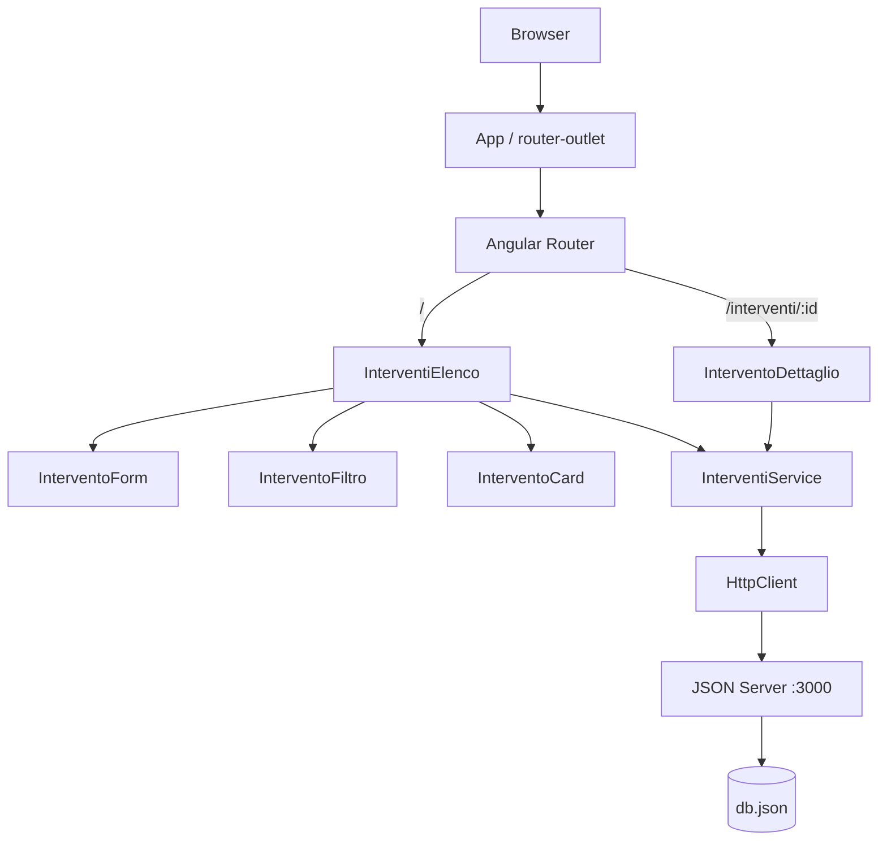
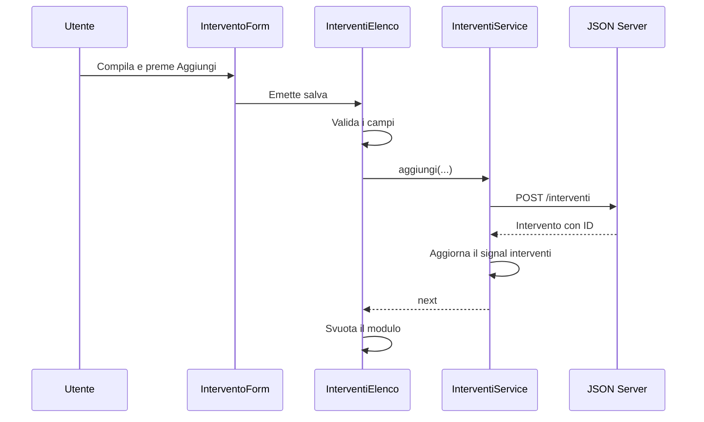

# Gestione interventi

Applicazione web realizzata con Angular per creare, consultare e aggiornare interventi tecnici. I dati vengono salvati localmente tramite JSON Server, che espone una piccola API REST basata sul file `db.json`.

Il progetto è completo nella configurazione descritta in questo documento e utilizza JSON Server come backend locale.

## Funzionalità

- Creazione di un intervento con cliente, descrizione, tecnico, data e note.
- Modifica di cliente, descrizione, tecnico e note.
- Data bloccata dopo la creazione.
- Flusso di stato `Da svolgere -> In corso -> Completato`.
- Eliminazione degli interventi.
- Ricerca per nome del cliente.
- Filtro per stato.
- Pagina di dettaglio raggiungibile tramite ID.
- Messaggi di caricamento, salvataggio ed errore.
- Layout responsive e navigabile da tastiera.
- Persistenza locale dei dati in `db.json`.

## Tecnologie

- Angular 22.2 con componenti standalone
- TypeScript 6
- Angular Router
- Angular Forms
- Angular HttpClient
- Signals e `computed`
- RxJS
- JSON Server
- Vitest tramite Angular CLI

## Avvio del progetto

### Prerequisiti

Servono Node.js e npm. Le dipendenze del progetto si installano con:

```bash
npm install
```

### 1. Avviare l'API locale

Dal terminale, nella cartella del progetto:

```bash
npm run api
```

JSON Server legge `db.json` ed espone gli interventi su:

```text
http://localhost:3000/interventi
```

### 2. Avviare Angular

In un secondo terminale:

```bash
npm start
```

L'applicazione è disponibile su:

```text
http://localhost:4200
```

Per arrestare uno dei server, selezionare il relativo terminale e premere `Ctrl+C`.

## Comandi disponibili

| Comando | Funzione |
| --- | --- |
| `npm install` | Installa le dipendenze. |
| `npm start` | Avvia il server di sviluppo Angular. |
| `npm run api` | Avvia JSON Server sulla porta 3000. |
| `npm test -- --watch=false` | Esegue una volta i test automatici. |
| `npm run build` | Genera la versione compilata in `dist/`. |
| `npm run watch` | Ricompila automaticamente in configurazione development. |

## Architettura generale

L'applicazione è divisa in quattro livelli principali:

1. **Pagine**: coordinano una schermata completa.
2. **Componenti**: mostrano o raccolgono una parte specifica dell'interfaccia.
3. **Servizio**: comunica con l'API e conserva lo stato condiviso.
4. **API locale**: persiste gli interventi nel file `db.json`.



## Routing e pagine

Il componente principale `App` è intenzionalmente molto piccolo. Il suo template contiene soltanto:

```html
<router-outlet />
```

`router-outlet` è lo spazio in cui Angular inserisce la pagina scelta in base all'indirizzo.

Le rotte sono definite in `src/app/app.routes.ts`:

| Indirizzo | Componente | Scopo |
| --- | --- | --- |
| `/` | `InterventiElenco` | Modulo, ricerca, filtri ed elenco. |
| `/interventi/:id` | `InterventoDettaglio` | Dettaglio dell'intervento indicato dall'ID. |

`provideRouter(routes)` in `app.config.ts` attiva il router. Nello stesso file, `provideHttpClient()` rende disponibile `HttpClient` al servizio.

### Pagina elenco

`InterventiElenco` è il componente coordinatore principale. Si occupa di:

- conservare i valori correnti del modulo;
- distinguere creazione e modifica tramite `idInModifica`;
- validare i campi prima del salvataggio;
- chiamare i metodi del servizio;
- svuotare il modulo dopo una risposta riuscita;
- combinare ricerca e filtro con `computed`;
- collegare gli eventi provenienti dai componenti figli.

La pagina non esegue direttamente richieste HTTP. Decide cosa deve fare l'interfaccia e delega l'accesso ai dati a `InterventiService`.

### Pagina dettaglio

`InterventoDettaglio` legge `id` dall'indirizzo usando `ActivatedRoute`.

Il parametro della rotta viene convertito in un signal con `toSignal`. Un `computed` cerca quindi l'intervento corrispondente nell'elenco fornito dal servizio. Se cambia l'ID nell'indirizzo, il valore viene ricalcolato.

La pagina distingue quattro casi:

- caricamento in corso;
- errore nel collegamento all'API;
- intervento trovato;
- ID inesistente.

## Componenti dell'interfaccia

### `InterventoForm`

Raccoglie i dati del modulo. Utilizza:

- `model()` per i valori modificabili in entrambe le direzioni;
- `input()` per modalità modifica, errore e stato di salvataggio;
- `output()` per notificare alla pagina le richieste di salvataggio e annullamento.

Il componente non salva direttamente i dati. Raccoglie l'input dell'utente e comunica le azioni alla pagina elenco.

### `InterventoFiltro`

Gestisce:

- testo della ricerca cliente;
- filtro per stato;
- numero di interventi visualizzati;
- numero totale di interventi.

Ricerca e stato vengono combinati nella proprietà `interventiFiltrati` della pagina elenco. Il filtro cambia soltanto ciò che viene mostrato e non modifica i dati salvati.

### `InterventoCard`

Riceve un `Intervento` tramite un input obbligatorio e ne mostra i dati. Emette eventi contenenti l'ID per:

- avviare l'intervento;
- completarlo;
- modificarlo;
- eliminarlo.

Contiene anche il `routerLink` che apre la pagina di dettaglio.

## Modello dei dati

Il contratto interno è definito in `src/app/models/intervento.ts`:

```ts
export interface Intervento {
  id: string;
  cliente: string;
  descrizione: string;
  dataIntervento: string;
  note: string;
  stato: 'Da svolgere' | 'In corso' | 'Completato';
  tecnico: string;
}
```

L'ID è una stringa generata da JSON Server. La data viene salvata nel formato prodotto da un campo HTML `type="date"`, ad esempio `2026-10-07`.

## Servizio e stato condiviso

`InterventiService` è registrato con `providedIn: 'root'`. Angular ne crea quindi una sola istanza condivisa tra pagina elenco e pagina dettaglio.

Il servizio contiene questi signal:

| Signal | Contenuto |
| --- | --- |
| `interventi` | Copia locale dell'elenco ricevuto dal server. |
| `caricamento` | Indica il caricamento iniziale. |
| `erroreCaricamento` | Messaggio relativo alla richiesta iniziale. |
| `salvataggio` | Indica una creazione o modifica in corso. |
| `erroreOperazione` | Errore di avvio, completamento o eliminazione. |

Il servizio usa `set()` per sostituire completamente un valore e `update()` per calcolarne uno nuovo partendo dal valore corrente.

## API locale

L'URL usato dal servizio è:

```text
http://localhost:3000/interventi
```

| Operazione | Metodo e percorso | Effetto |
| --- | --- | --- |
| Lettura | `GET /interventi` | Carica tutti gli interventi. |
| Creazione | `POST /interventi` | Crea un intervento e genera l'ID. |
| Modifica | `PATCH /interventi/:id` | Modifica cliente, descrizione, tecnico e note. |
| Avvio | `PATCH /interventi/:id` | Imposta lo stato su `In corso`. |
| Completamento | `PATCH /interventi/:id` | Imposta lo stato su `Completato`. |
| Eliminazione | `DELETE /interventi/:id` | Elimina l'intervento. |

JSON Server riceve la richiesta, modifica `db.json` e restituisce una risposta. Soltanto dopo la risposta il servizio aggiorna il signal locale.

## Flusso di creazione



`aggiungi()` restituisce un Observable. La pagina esegue `subscribe()` perché deve sapere quando il salvataggio è riuscito e può quindi pulire il modulo.

Nel servizio:

- `tap()` aggiorna l'elenco locale senza trasformare la risposta;
- `finalize()` disattiva sempre lo stato di salvataggio, sia in successo sia in errore.

## Flusso di modifica

Quando si preme **Modifica**, la pagina cerca l'intervento tramite `find()` e copia nel modulo cliente, descrizione, tecnico e note. La data non viene copiata perché non è modificabile.

Al salvataggio:

1. `idInModifica` indica che esiste già un intervento;
2. la pagina chiama `aggiorna()`;
3. il servizio invia un `PATCH` senza la data;
4. `map()` sostituisce nell'elenco locale soltanto l'elemento con lo stesso ID;
5. la pagina svuota il modulo dopo `next`.

## Avvio, completamento ed eliminazione

Per avvio e completamento, il servizio invia un `PATCH` contenente soltanto il nuovo stato. La copia locale viene aggiornata con `map()`.

Per l'eliminazione, JSON Server normalmente non restituisce un nuovo elenco. Dopo il successo della `DELETE`, il servizio usa `filter()` per creare una copia locale senza l'elemento eliminato.

Se viene eliminato l'intervento attualmente in modifica, la pagina azzera anche il modulo.

## Regole applicative

- Cliente, descrizione e tecnico sono sempre obbligatori.
- La data è obbligatoria soltanto durante la creazione.
- La data non compare nel modulo di modifica e non viene inviata nel `PATCH`.
- Un nuovo intervento nasce nello stato `Da svolgere`.
- Il flusso previsto è `Da svolgere -> In corso -> Completato`.
- Ricerca e filtro agiscono soltanto sulla visualizzazione.
- Il modulo viene svuotato solo dopo un salvataggio riuscito.
- Durante il salvataggio i controlli vengono disabilitati per evitare invii ripetuti.

## Gestione degli errori

L'applicazione distingue:

- errore nel caricamento iniziale;
- errore durante creazione o modifica;
- errore durante avvio, completamento o eliminazione;
- ID non presente nella pagina di dettaglio.

Se una creazione o modifica fallisce, i dati restano nel modulo per consentire una nuova prova. Gli errori tecnici vengono scritti nella console, mentre nell'interfaccia appare un messaggio comprensibile.

## Struttura delle cartelle

```text
gestione-interventi/
|- db.json
|- package.json
|- src/
   |- styles.css
   |- app/
      |- app.ts
      |- app.html
      |- app.config.ts
      |- app.routes.ts
      |- models/
      |  |- intervento.ts
      |- services/
      |  |- interventi.service.ts
      |- pages/
      |  |- interventi-elenco/
      |  |- intervento-dettaglio/
      |- components/
         |- intervento-form/
         |- intervento-filtro-stato/
         |- intervento-card/
```

Ogni componente e pagina utilizza tre file:

- `.ts` per stato e comportamento;
- `.html` per il template;
- `.css` per lo stile isolato del componente.

`src/styles.css` contiene invece gli stili globali, come sfondo, font e box sizing.

## Test e compilazione

Esecuzione singola dei test:

```bash
npm test -- --watch=false
```

Controllo TypeScript senza generare file:

```bash
npx tsc --noEmit -p tsconfig.app.json
```

Build di produzione:

```bash
npm run build
```

La build viene salvata in:

```text
dist/gestione-interventi
```

## Verifica manuale consigliata

1. Avviare API e applicazione.
2. Creare un intervento con data e note.
3. Ricaricare la pagina e verificare la persistenza.
4. Modificare i campi consentiti e controllare che la data resti invariata.
5. Passare da `Da svolgere` a `In corso` e poi a `Completato`.
6. Cercare il cliente e applicare il filtro per stato.
7. Aprire il dettaglio e provare anche un ID inesistente.
8. Eliminare l'intervento.
9. Arrestare JSON Server e verificare i messaggi di errore.
10. Provare la navigazione con `Tab` e una finestra stretta.

## Persistenza e Git

`db.json` viene modificato automaticamente durante le prove. Prima di creare un commit, controllare sempre:

```bash
git status --short
```

Per salvare il codice senza includere nuovi dati di prova:

```bash
git add src README.md package.json package-lock.json
git commit -m "Descrive architettura e utilizzo del progetto"
```

Per includere intenzionalmente anche i dati correnti:

```bash
git add db.json
git commit -m "Aggiorna dati di esempio"
```

## Limiti dichiarati

- Il backend è JSON Server e deve essere avviato separatamente.
- Non sono presenti autenticazione e gestione degli utenti.
- Non sono gestiti caricamenti di allegati o notifiche.
- Gli stati seguono un flusso lineare e non prevedono la riapertura.
- Il progetto utilizza dati locali ed è pensato come applicazione completa dimostrativa.
